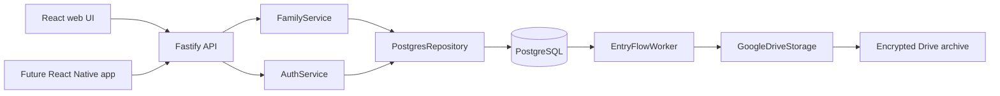

# Architecture and stack choices

The web client uses React, Vite, TypeScript, and Lucide icons. The API uses Fastify, Zod, PostgreSQL, native scrypt password hashing, and encrypted contacts. Node services and repositories use classes and dependency injection; React uses idiomatic functional components. OOP is applied to business logic and integrations, where it makes later changes easier.

Next.js is also viable, particularly for public family-history pages and server-rendered content. For the current authenticated app, Vite keeps the frontend lightweight and the backend independent. A future React Native/Expo mobile app can reuse TypeScript models and API contracts; platform-specific screens remain separate. There is no universally best stack without measured workload, team, and deployment constraints.

## IDs and relationships

A family tree is a graph, rather than a linked list: a person may have several parental relationships, a partner, siblings, and multiple children. `families.id` scopes each tree. `members.id` identifies each person. `relationships.from_id` is the parent and `to_id` is the child for a parent edge. Partner edges are separate. A single `parent_id` column would lose these distinctions.

Composite foreign keys keep both ends of a relationship inside one Family ID. The create-member operation inserts a new vertex, so it cannot create an ancestry cycle. The API deliberately does not expose arbitrary relationship rewiring. Before adding reparenting or tree merges, lock the family and check ancestors for cycles in the same transaction. Do not infer marriage, gender, biological parenthood, religion, caste, or gotra from names.

## Performance

`FamilyGraph` builds adjacency lists using O(V+E) space. Breadth-first relationship search and descendant collection use O(V+E) time. Visited sets keep traversals finite. Storage is proportional to members and edges; no full ancestor matrix is stored. PostgreSQL indexes scope member lookups and relationship traversals by family. [Recursive PostgreSQL queries](https://www.postgresql.org/docs/16/queries-with.html) can handle deeper server-side graph traversal as trees grow.

This MVP loads an entire family for rendering and evaluates sharing rules in memory. That is suitable for small family trees, not an unbounded social graph. Before large trees, add family-size limits, query pagination, cached branch membership, virtualized rendering, SQL-side visibility filtering, and load tests. The current row layout is deterministic by generation, not a full genealogy layout engine; adoption labels, overlapping partnerships, collapse/expand, and complex tree merging are future work.

## Boundaries

- `frontend/src/data.ts`: an interface plus demo/API repositories. UI actions do not contain SQL or provider credentials.
- `shared/src/index.ts`: shared validation and graph rules for web/mobile/server.
- `backend/src/app.ts`: HTTP validation and response mapping.
- `AuthService`: account registration, password verification, opaque sessions.
- `FamilyService`: authorization and family business rules.
- `PostgresRepository`: parameterized persistence and transaction boundaries.
- `EntryFlowService`: one encrypted event per committed business entry.
- `GoogleDriveStorage`: OAuth refresh and encrypted archive transport.
- `EntryFlowWorker`: leases, retries, provider IDs, success/failure transitions.

The worker accepts an `ArchiveStorage` interface, so object storage or another archive target can be substituted without changing family logic. PostgreSQL remains authoritative; a Drive outage does not prevent family entries from being saved.
